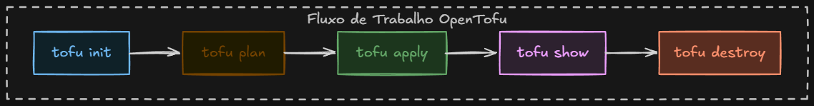

# 4. Fluxo de trabalho do OpenTofu



Todo projeto OpenTofu segue o mesmo ciclo. Os comandos sempre leem os arquivos `.tofu` da **pasta atual**.

| Etapa | Comando | O que faz | Acessa a AWS? | Arquivos que toca |
|-------|---------|-----------|---------------|-------------------|
| 1 | `tofu init` | Prepara a pasta: baixa providers | Não | cria `.terraform/` e `.terraform.lock.hcl` |
| 2 | `tofu plan` | Compara **código x state x AWS** e mostra o que mudaria | Só lê | nenhum |
| 3 | `tofu apply` | Executa o plano depois do seu `yes` | **Escreve** | atualiza `terraform.tfstate` |
| 4 | `tofu show` | Mostra o que está no state, de forma legível | Não | só lê o state |
| 5 | `tofu destroy` | Apaga tudo que o projeto gerencia | **Escreve** | esvazia o state |

> Antes de tudo: `source .env` (credenciais, ver [02-credenciais-aws.md](02-credenciais-aws.md)).

## 1. `tofu init`: preparar

Roda uma vez por projeto, e de novo ao mudar providers, módulos ou backend. Detalhes em [03-providers-e-init.md](03-providers-e-init.md).

## 2. `tofu plan`: simular

```bash
tofu plan
```

1. Faz *refresh*: pergunta à AWS como os recursos do state estão de verdade.
2. Compara com o que está no código.
3. Mostra o diff (`+` criar, `~` alterar, `-` destruir, `-/+` recriar).

Não muda nada, pode rodar quantas vezes quiser. Antes dele, vale rodar `tofu fmt` (formata) e `tofu validate` (checa a sintaxe).

## 3. `tofu apply`: executar

```bash
tofu apply
```

Gera o plano de novo, mostra e pede `yes`. Ao terminar, grava o resultado no `terraform.tfstate`. Se der erro no meio, o que já foi criado fica registrado no state; é só corrigir e rodar de novo.

> Para garantir que o apply execute **exatamente** o plano revisado: `tofu plan -out=plano.tfplan` e depois `tofu apply plano.tfplan`.

## 4. `tofu show`: inspecionar

```bash
tofu show
```

Exemplo com o bucket deste projeto (resumido):

```
# aws_s3_bucket.algadelivery-teste-devops:
resource "aws_s3_bucket" "algadelivery-teste-devops" {
    arn                         = "arn:aws:s3:::algadelivery-teste-devops"
    bucket                      = "algadelivery-teste-devops"
    bucket_domain_name          = "algadelivery-teste-devops.s3.amazonaws.com"
    bucket_region               = "us-east-1"
    id                          = "algadelivery-teste-devops"
    ...
}
```

Aqui aparecem os valores que no plan eram `(known after apply)`, como o `arn`.

Atenção: o `show` lê **só o state** e não consulta a AWS. Se alguém apagou o recurso pelo console, o `show` continua exibindo o recurso. Para comparar com a realidade, use `tofu plan -refresh-only` (ver *drift* em [08-state.md](08-state.md)).

Variações:
- `tofu state list`: só os endereços dos recursos.
- `tofu state show <endereço>`: um recurso só.
- `tofu show plano.tfplan`: mostra um plano salvo.

## 5. `tofu destroy`: limpar

```bash
tofu destroy
```

Mostra o que será apagado (`-`) e pede `yes`. Em estudo, rode sempre no fim para **não pagar por recursos esquecidos**.

Para apagar só um recurso, o jeito certo é removê-lo do código e rodar `apply`. O `-target` é para exceções.

## O ciclo na prática

O fluxo da imagem é o ciclo de vida completo. No dia a dia você fica num loop:

```
editar .tofu → fmt → validate → plan → apply → (show) → editar de novo…
```

O `destroy` vem só no fim, e o `init` só volta quando você mexer em providers.
