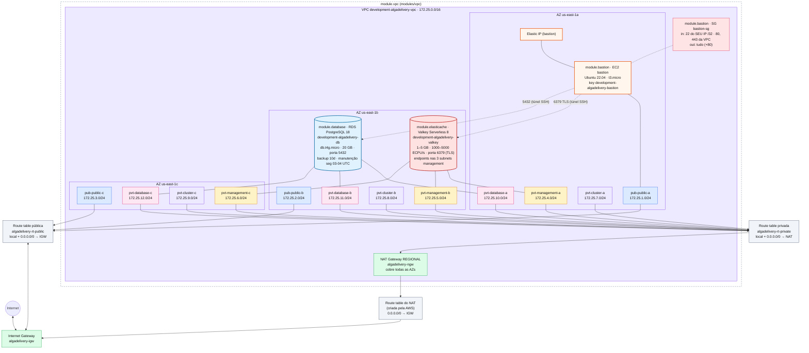

# Arquitetura atual

> Diagrama vivo: atualizado a cada mudança no código. **Última atualização: 2026-10-23**, com o **módulo ElastiCache** (Valkey Serverless).
> O diagrama mostra o ambiente **dev** (`envs/dev`, aplicado). O prod é idêntico, com a VPC `172.26.0.0/16` (ver [Ambientes](#ambientes)).
> State do dev: `s3://algadelivery-tfstate-devops/algadelivery/development/remote.tfstate` · Região: `us-east-1`
> **Situação:** o dev foi **destruído** (state vazio; na AWS não há VPC, NAT nem RDS do projeto → custo zero). O código descreve **41 recursos** (29 `module.vpc` + 6 `module.bastion` + 4 `module.database` + 2 `module.elasticache`); o `plan` mostra 41 to add. Prod: não inicializado.

## Ambientes

| Ambiente | Pasta | State (S3) | VPC | Status |
|----------|-------|------------|-----|--------|
| development | `envs/dev` | `algadelivery/development/remote.tfstate` | `172.25.0.0/16` · `development-algadelivery-vpc` | 💤 destruído (código: 41 recursos) |
| production | `envs/prod` | `algadelivery/production/remote.tfstate` | `172.26.0.0/16` · `production-algadelivery-vpc` | ⏸️ precisa de `tofu init -reconfigure` |

Os dois usam os mesmos módulos (`modules/vpc`, `modules/ec2`, `modules/rds`, `modules/elasticache`). Os CIDRs não se sobrepõem. Detalhes em [24-multiplos-ambientes.md](24-multiplos-ambientes.md).

## Diagrama



**Legenda:** 🟦 pública · 🟨 privada de gerenciamento · 🟪 privada do cluster · 🌸 privada database · 🟩 gateways · ⬜ route tables · 🟥 security groups · 🟧 EC2/Elastic IP · 🟥 (borda grossa) ElastiCache Valkey · moldura tracejada = módulo `vpc` (o bastion, o SG e o EIP ficam na raiz, mas aparecem dentro da VPC porque moram nela). Seta de mão dupla = entrada e saída; seta simples = só saída. Linha pontilhada = SG aplicado à EC2; linha cheia EC2—subnet = "mora nesta subnet".

> Para ver o diagrama renderizado: GitHub, ou no VS Code com uma extensão de Mermaid (ex.: *Markdown Preview Mermaid Support*).

## Versão texto (para o terminal)

```
                                   Internet
                                      │ ▲
                            ┌─────────▼─┴───────┐
                            │ Internet Gateway  │ algadelivery-igw
                            └──▲─────────────▲──┘
                               │             │ rt do NAT (AWS): 0.0.0.0/0 → igw
 rt-public: 0.0.0.0/0 → igw    │             │
┌──────────────────────────────┼─────────────┼────────────────────────────────┐
│ VPC 172.25.0.0/16            │   ┌─────────┴────────────┐                   │
│                              │   │ NAT Gateway REGIONAL │ algadelivery-ngw  │
│                              │   └─────────▲────────────┘                   │
│                              │             │ rt-private: 0.0.0.0/0 → nat    │
│                              │             │                                │
│    us-east-1a           us-east-1b                 us-east-1c               │
│  ┌──────────────────┐  ┌──────────────────┐   ┌──────────────────┐          │
│  │ pub-a     .1/24  │  │ pub-b     .2/24  │   │ pub-c     .3/24  │ → rt-public
│  │ mgmt-a    .4/24  │  │ mgmt-b    .5/24  │   │ mgmt-c    .6/24  │ → rt-private
│  │ cluster-a .7/24  │  │ cluster-b .8/24  │   │ cluster-c .9/24  │ → rt-private
│  │ database-a .10/24│  │ database-b .11/24│   │ database-c .12/24│ → rt-private
│  └──────────────────┘  └──────────────────┘   └──────────────────┘          │
│                                                                             │
│  module.bastion: EC2 bastion (pub-a) + EIP + SG bastion-sg + key/.pem      │
│  (module.rancher está comentado nos dois ambientes)                        │
│  SGs: in 22 do SEU IP · 80/443 da VPC · out tudo                            │
│  module.database: RDS PostgreSQL 18 no subnet group database (a,b,c),       │
│                   SG db-sg: in 5432 da VPC · senha no Secrets Manager       │
│  module.elasticache: Valkey Serverless 8 nas subnets management (a,b,c),   │
│                   SG valkey-sg: in 6379 da VPC · TLS obrigatório            │
│        você ──SSH──► Elastic IP ──► bastion                                 │
└─────────────────────────────────────────────────────────────────────────────┘
```

## Recursos (no código)

| Recurso | Endereço no OpenTofu | Detalhe | Qtd |
|---------|----------------------|---------|-----|
| VPC | `module.vpc.aws_vpc.main` | `172.25.0.0/16` | 1 |
| Subnets públicas (grupo `public`) | `module.vpc.aws_subnet.public["pub_a\|b\|c"]` | `172.25.1-3.0/24` · `algadelivery-pub-public-{a,b,c}` | 3 |
| Subnets privadas (grupos `management`, `cluster`, `database`) | `module.vpc.aws_subnet.private["pvt_mgmt_*"\|"pvt_cluster_*"\|"pvt_db_*"]` | `172.25.4-12.0/24` · `algadelivery-pvt-<grupo>-{a,b,c}` | 9 |
| Internet Gateway | `module.vpc.aws_internet_gateway.main` | `algadelivery-igw` | 1 |
| NAT Gateway (regional) | `module.vpc.aws_nat_gateway.main` | `algadelivery-ngw` · 💲 por hora | 1 |
| Route table pública | `module.vpc.aws_route_table.public` | `0.0.0.0/0 → IGW` | 1 |
| Route table privada | `module.vpc.aws_route_table.private` | `0.0.0.0/0 → NAT` (`nat_gateway_id` ✅) | 1 |
| Associations públicas | `module.vpc.aws_route_table_association.public[...]` | 3 subnets → rt-public | 3 |
| Associations privadas | `module.vpc.aws_route_table_association.private[...]` | 9 subnets → rt-private | 9 |
| **module.bastion** (`modules/ec2`) | `module.bastion.aws_instance.main` · `.aws_eip.main[0]` · `.aws_security_group.main` · `.aws_key_pair.main` · `.tls_private_key.main` · `.local_sensitive_file.private_key` | EC2 `bastion` (pub-a, `t3.micro`) · SG `bastion-sg` · key `development-algadelivery-bastion` · `envs/dev/development-algadelivery-bastion.pem` · 💲 | 6 |
| **module.database** (`modules/rds`) | `module.database.aws_db_instance.main` · `.aws_db_subnet_group.main` · `.aws_db_parameter_group.main` · `.aws_security_group.main` | RDS `development-algadelivery-db` (PostgreSQL 18, `db.t4g.micro`, 20 GB) · subnet group nas 3 subnets database · parameter group `postgres18` · SG 5432 · backup 10 dias (02-03 UTC) · manutenção Mon 03-04 UTC · 💲 | 4 |
| **module.elasticache** (`modules/elasticache`) | `module.elasticache.aws_elasticache_serverless_cache.main` · `.aws_security_group.main` | Valkey Serverless `development-algadelivery-valkey` (major 8, 1–5 GB, 1000–5000 ECPU/s, snapshots desligados) nas 3 subnets management · SG `development-algadelivery-valkey-sg` 6379 · `prevent_destroy = true` · 💲 | 2 |
| **Total (dev)** | | | **41** (no código; nenhum aplicado no momento) |

`module.rancher` está comentado em `envs/dev/ec2.tofu` e `envs/prod/ec2.tofu`.

Data sources (leituras, não contam como recursos): `data.http.my_public_ip` e `data.aws_ami.ubuntu`.

Os IDs (`vpc-…`, `igw-…`, `rtb-…`) mudam a cada `destroy`/`apply`; consulte com `tofu output` (inclui `route_table_public_id` e `route_table_private_id`).

## Mapa de CIDRs

```
172.25.0.0/16
├── 172.25.0.0/24        livre
├── 172.25.1-3.0/24      públicas            (a, b, c)  → rt-public
├── 172.25.4-6.0/24      privadas management (a, b, c)  → rt-private
├── 172.25.7-9.0/24      privadas cluster    (a, b, c)  → rt-private
├── 172.25.10-12.0/24    privadas database   (a, b, c)  → rt-private
└── 172.25.13.0 … .255   livre (~243 blocos /24)
```

## Fluxos de tráfego (após o `apply`)

| Fluxo | Caminho | Funciona? |
|-------|---------|-----------|
| Subnet privada → internet (só saída) | subnet privada → rt-private → NAT → rt do NAT → IGW → Internet | ✅ (`nat_gateway_id` corrigido no módulo) |
| Subnet pública → internet | subnet pública → rt-public → IGW → Internet | ✅ se o recurso tiver IP público |
| Internet → recurso público (ex.: ALB) | Internet → IGW → rt-public → subnet pública | ✅ se o recurso tiver IP público + security group liberando |
| Internet → subnet privada | não existe, **por design** | 🔒 bloqueado, como deve ser |
| Entre subnets da VPC | rota `local` automática em todas as tabelas | ✅ (rota) · a porta depende do SG de destino |
| Bastion/app → Valkey | recurso da VPC → rota `local` → endpoint do cache (`valkey-sg`: 6379 de `172.25.0.0/16`) | ⏳ após o apply · sempre com TLS (`redis-cli --tls`, `rediss://`) · da sua máquina: túnel pelo bastion (doc 27) |
| Bastion/app → RDS | recurso da VPC → rota `local` → RDS (`db-sg`: 5432 de `172.25.0.0/16`) | ⏳ após o apply · da sua máquina: túnel `ssh -L 5432:<endpoint>:5432` pelo bastion (doc 26) |
| SSH: você → bastion | Seu IP → IGW → rt-public → Elastic IP → EC2 bastion (`bastion_sg`: 22 só do seu IP `/32`) | ✅ (em `envs/dev`) `ssh -i development-algadelivery-bastion.pem ubuntu@ELASTIC_IP` |
| SSH: bastion → VM privada | — | ⏸️ a VM privada saiu do código |

## Pendências

> Data sources (`data.http.my_public_ip`, `data.aws_ami.ubuntu`) não aparecem no diagrama: não são recursos, só leituras.

0. 🔴 **RDS: nomes sem o ambiente** (`algadelivery-db-subnet-group` e `algadelivery-db-parameter-group` são únicos por conta/região): o apply do 2º ambiente falha. Prefixe com `${var.environment}` ([doc 26](26-modulo-rds.md#1--nomes-sem-o-ambiente-o-prod-vai-colidir-com-o-dev)). Também: tag `Name` do banco = nome do parameter group; `storage_encrypted`/`deletion_protection` ausentes; `db_multi_az`, `db_port` e o provider `random` (só no dev) sem uso; as subnets database saem pelo NAT.
1. ⏸️ **Prod:** `cd envs/prod && tofu init -reconfigure` (o `.terraform/` foi copiado e aponta para o backend antigo; agora também falta instalar o `module "database"`).
2. ⚠️ **A key do backend vem de `var.environment`:** um `-var environment=...` na pasta errada aponta para o state do outro ambiente. Fixe a key por pasta ou trave com `validation` ([doc 24](24-multiplos-ambientes.md#1-a-key-do-backend-depende-de-uma-variável)).
3. ⚠️ **Os envs já divergem** (nome do bastion, key pair, `[0]` x `["0"]`, rancher comentado diferente). Padronize ou afine os envs ([doc 24](24-multiplos-ambientes.md#2-código-duplicado-os-ambientes-já-divergiram)). O rancher comentado do dev tem `instance_type = "${var.environment}-${var.keypair_name}"`, um bug se for descomentado.
4. Commitar a reorganização (`.tofu` da raiz apagados + `envs/` novo).
5. Módulo `ec2`: `associate_public_ip_address = true` fixo; `key_name` via variável + `depends_on`; inputs sem `description`. ✅ AMI nova não recria mais (`ignore_changes = [ami]`).
5a. ✅ ~~`prevent_destroy` bloqueando o destroy~~: hoje está `false` no módulo (o dev foi destruído). Para proteger só o prod, use uma variável ([doc 25](25-lifecycle.md#prevent_destroy-por-ambiente-com-variável)).
5c. ⚠️ **RDS backup/manutenção:** janelas em **UTC** (backup 02–03 UTC = 23–00h Brasília); os **defaults do módulo se sobrepõem** (backup 03–04 dentro de Mon 02–04); `db_backup_retention_period` como `string`; dev e prod com os mesmos valores; com `skip_final_snapshot = true` os backups somem no destroy ([doc 26](26-modulo-rds.md#passo-4b-backup-automático-e-janela-de-manutenção)).
5d. 🔴 **ElastiCache** ([doc 27](27-modulo-elasticache.md)): `prevent_destroy = true` fixo → o `tofu destroy` do dev **volta a falhar**; os **mínimos** (1 GB + 1000 ECPU/s) são cobrados sempre (~US$ 67/mês por ambiente); default do módulo `"9"` x env `"8"`; sem `user_group_id` (sem senha, só a rede protege); SG da VPC inteira + egress sem uso; mesmos valores em dev e prod.
5b. ⚠️ **`create_before_destroy` no SG com `name` fixo** (agora nos 3 módulos com SG): uma substituição criaria dois SGs com o mesmo nome (`InvalidGroup.Duplicate`). Use `name_prefix` (doc 25). `tofu fmt -recursive` pendente em `modules/ec2/main.tofu`, `modules/rds/variables.tofu`, `envs/prod/local.tofu` e `envs/prod/variables.tofu`.
6. Chaves de subnets precisam ser únicas entre grupos (`validation`, doc 22). Grupo `database` fora dos outputs; as subnets database saem pelo NAT.
7. Regras do SG: entrada 80/443 da VPC sem uso; saída 80 redundante (doc 20). O SSH usa o IP de quem roda o tofu (doc 18).
8. 💲 Custos **por ambiente**: NAT (~US$ 0,045/h) + `t3.micro` + Elastic IP. + RDS `db.t4g.micro` (~US$ 0,016/h) + Secrets Manager + **Valkey Serverless** (~US$ 0,09/h com os mínimos atuais; ~US$ 6/mês sem mínimos). Subir o prod dobra. `tofu destroy` em cada pasta ao terminar (o do ec2 foi liberado, mas o `prevent_destroy` do ElastiCache bloqueia de novo, ver 5d).

## Histórico da arquitetura

| Data | Mudança |
|------|---------|
| 2026-10-19 | VPC `172.25.0.0/16` |
| 2026-10-19 | 3 subnets públicas |
| 2026-10-20 | Subnets via `for_each` · Internet Gateway |
| 2026-10-20 | 6 subnets privadas (management + cluster) · NAT Gateway regional · tags `Environment`/`ManagedBy` |
| 2026-10-20 | Route tables pública (→ IGW) e privada (→ NAT) + 9 associations: rede básica completa |
| 2026-10-20 | Security Groups `bastion_sg` e `vm_private_sg` (SSH) · outputs dos IDs das route tables |
| 2026-10-20 | Data source `http` (seu IP) → SSH do bastion só do seu IP `/32` · tags via `merge(local.common_tags, …)` · provider `http` |
| 2026-10-20 | EC2 bastion (pub-a) e VM privada (mgmt-a) · AMI Ubuntu via `data.aws_ami` · chave SSH gerada (`tls` + `aws_key_pair` + `.pem` local) · providers `tls` e `local` |
| 2026-10-23 | Módulo **`modules/elasticache`**: `module.elasticache` (Valkey Serverless 8, limites 1–5 GB / 1000–5000 ECPU/s, subnets management, SG 6379) · ⏳ não aplicado (plan 41) |
| 2026-10-23 | RDS com **backup automático** (10 dias, janela 02–03 UTC) e **janela de manutenção** (Mon 03–04 UTC) · dev destruído (`prevent_destroy = false`) |
| 2026-10-23 | Módulo **`modules/rds`**: `module.database` (PostgreSQL 18, subnet group nas subnets database, parameter group com `dynamic`, SG 5432, senha no Secrets Manager) · ⏳ não aplicado |
| 2026-10-23 | `lifecycle` no módulo `ec2`: instância com `ignore_changes = [ami]` + `prevent_destroy`; SG com `create_before_destroy` |
| 2026-10-22 | **Ambientes**: root module movido para `envs/dev` e `envs/prod` (mesmos módulos, states `algadelivery/<env>/remote.tfstate`, VPCs `172.25` / `172.26`) · dev aplicado do zero · rancher comentado |
| 2026-10-22 | Módulo **`modules/ec2`** (chave, key pair, `.pem`, SG com dynamic, EC2, EIP com `count`) chamado 2×: `bastion` e `rancher` · conflitos de nome corrigidos · `security_group.tofu` da raiz removido |
| 2026-10-22 | Subnets em grupos (`map(map(object))`, achatadas com `merge([for ...]...)`) · `aws_subnet.private` único · grupo **database** (`172.25.10-12.0/24`) · outputs agrupados · tags `pub-public-*` / `pvt-<grupo>-*` |
| 2026-10-20 | Rede movida para o **módulo `modules/vpc`** (`vpc.tofu` chama; outputs repassados) · `nat_gateway_id` corrigido · tag da VPC → `algadelivery-vpc` · outputs de bastion/SG/EIP/key pair |
| 2026-10-20 | Regras do SG do bastion via `dynamic` blocks (listas em variável + padrões no local) · Elastic IP no bastion · VM privada e `vm_private_sg` removidas · `*.pem` no `.gitignore` |

Detalhes de cada mudança: [CHANGELOG.md](CHANGELOG.md).
