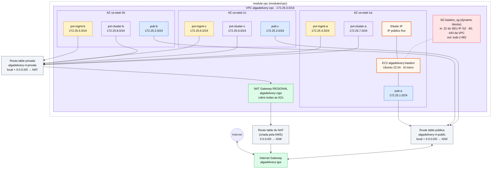

# Arquitetura atual

> Diagrama vivo: atualizado a cada mudança no código. **Última atualização: 2026-10-20**, com a rede movida para o **módulo `modules/vpc`**.
> State: `s3://algadelivery-tfstate-devops/development/networking/remote.tfstate` · Região: `us-east-1` · Ambiente: `development`
> **Situação:** o código tem **29 recursos** (22 dentro de `module.vpc` + 7 na raiz). 🔴 **Sem blocos `moved`, o próximo `apply` destrói e recria a rede inteira** (plan real: 26 add / 27 destroy). Com `moved`, o plan testado fica em 2 add / 2 change / 2 destroy ([doc 21](21-modules.md#refatorar-sem-destruir-blocos-moved)).

## Diagrama



**Legenda:** 🟦 pública · 🟨 privada de gerenciamento · 🟪 privada do cluster · 🟩 gateways · ⬜ route tables · 🟥 security groups · 🟧 EC2/Elastic IP · moldura tracejada = módulo `vpc` (o bastion, o SG e o EIP ficam na raiz, mas aparecem dentro da VPC porque moram nela). Seta de mão dupla = entrada e saída; seta simples = só saída. Linha pontilhada = SG aplicado à EC2; linha cheia EC2—subnet = "mora nesta subnet".

> Para ver o diagrama renderizado: GitHub, ou no VS Code com uma extensão de Mermaid (ex.: *Markdown Preview Mermaid Support*).

## Versão texto (para o terminal)

```
                                   Internet
                                      │ ▲
                            ┌─────────▼─┴───────┐
                            │ Internet Gateway  │ algadelivery-igw
                            └──▲─────────────▲──┘
                               │             │ rt do NAT (AWS): 0.0.0.0/0 → igw
 rt-public: 0.0.0.0/0 → igw    │             │
┌──────────────────────────────┼─────────────┼────────────────────────────────┐
│ VPC 172.25.0.0/16            │   ┌─────────┴────────────┐                   │
│                              │   │ NAT Gateway REGIONAL │ algadelivery-ngw  │
│                              │   └─────────▲────────────┘                   │
│                              │             │ rt-private: 0.0.0.0/0 → nat    │
│                              │             │                                │
│    us-east-1a           us-east-1b                 us-east-1c               │
│  ┌──────────────────┐  ┌──────────────────┐   ┌──────────────────┐          │
│  │ pub-a     .1/24  │  │ pub-b     .2/24  │   │ pub-c     .3/24  │ → rt-public
│  │ mgmt-a    .4/24  │  │ mgmt-b    .5/24  │   │ mgmt-c    .6/24  │ → rt-private
│  │ cluster-a .7/24  │  │ cluster-b .8/24  │   │ cluster-c .9/24  │ → rt-private
│  └──────────────────┘  └──────────────────┘   └──────────────────┘          │
│                                                                             │
│  SG bastion_sg (dynamic): in 22 do SEU IP · 80/443 da VPC · out tudo        │
│  EC2 algadelivery-bastion (pub-a) + Elastic IP (IP público fixo)            │
│        você ──SSH──► Elastic IP ──► bastion                                 │
│  (VM privada e vm_private_sg saíram do código)                              │
└─────────────────────────────────────────────────────────────────────────────┘
```

## Recursos (no código)

| Recurso | Endereço no OpenTofu | Detalhe | Qtd |
|---------|----------------------|---------|-----|
| VPC | `module.vpc.aws_vpc.main` | `172.25.0.0/16` | 1 |
| Subnets públicas | `module.vpc.aws_subnet.public["public_a\|b\|c"]` | `172.25.1-3.0/24` | 3 |
| Subnets privadas de gerenciamento | `module.vpc.aws_subnet.private_management["private_a\|b\|c"]` | `172.25.4-6.0/24` | 3 |
| Subnets privadas do cluster | `module.vpc.aws_subnet.private_cluster["private_a\|b\|c"]` | `172.25.7-9.0/24` | 3 |
| Internet Gateway | `module.vpc.aws_internet_gateway.main` | `algadelivery-igw` | 1 |
| NAT Gateway (regional) | `module.vpc.aws_nat_gateway.main` | `algadelivery-ngw` · 💲 por hora | 1 |
| Route table pública | `module.vpc.aws_route_table.public` | `0.0.0.0/0 → IGW` | 1 |
| Route table privada | `module.vpc.aws_route_table.private` | `0.0.0.0/0 → NAT` (`nat_gateway_id` ✅) | 1 |
| Associations públicas | `module.vpc.aws_route_table_association.public[...]` | 3 subnets → rt-public | 3 |
| Associations privadas | `module.vpc.aws_route_table_association.private_management[...]` / `.private_cluster[...]` | 6 subnets → rt-private | 6 |
| Security Group do bastion | `aws_security_group.bastion` | `bastion_sg` · regras via `dynamic` (in 22 do seu IP, 80/443 da VPC; out tudo + 80) | 1 |
| Chave SSH (gerada) | `tls_private_key.algadelivery` | RSA 4096 (⚠️ fica no state) | 1 |
| Key pair na AWS | `aws_key_pair.algadelivery` | `algadelivery-iac` (chave pública) | 1 |
| Arquivo da chave privada | `local_sensitive_file.private_key` | `./algadelivery-iac.pem` (0400) · `*.pem` no `.gitignore` ✅ | 1 |
| EC2 bastion | `aws_instance.bastion` | Ubuntu 22.04 · `t3.micro` · pub-a · 💲 | 1 |
| Elastic IP do bastion | `aws_eip.bastion` | IP público fixo · 💲 | 1 |
| **Total** | | | **29** |

Saíram do código (o próximo apply destrói): `aws_instance.vm_private` e `aws_security_group.vm_private`.

Data sources (leituras, não contam como recursos): `data.http.my_public_ip` e `data.aws_ami.ubuntu`.

Os IDs (`vpc-…`, `igw-…`, `rtb-…`) mudam a cada `destroy`/`apply`; consulte com `tofu output` (inclui `route_table_public_id` e `route_table_private_id`).

## Mapa de CIDRs

```
172.25.0.0/16
├── 172.25.0.0/24        livre
├── 172.25.1-3.0/24      públicas            (a, b, c)  → rt-public
├── 172.25.4-6.0/24      privadas management (a, b, c)  → rt-private
├── 172.25.7-9.0/24      privadas cluster    (a, b, c)  → rt-private
└── 172.25.10.0 … .255   livre (~246 blocos /24)
```

## Fluxos de tráfego (após o `apply`)

| Fluxo | Caminho | Funciona? |
|-------|---------|-----------|
| Subnet privada → internet (só saída) | subnet privada → rt-private → NAT → rt do NAT → IGW → Internet | ✅ (`nat_gateway_id` corrigido no módulo) |
| Subnet pública → internet | subnet pública → rt-public → IGW → Internet | ✅ se o recurso tiver IP público |
| Internet → recurso público (ex.: ALB) | Internet → IGW → rt-public → subnet pública | ✅ se o recurso tiver IP público + security group liberando |
| Internet → subnet privada | não existe, **por design** | 🔒 bloqueado, como deve ser |
| Entre subnets da VPC | rota `local` automática em todas as tabelas | ✅ (rota) · a porta depende do SG de destino |
| SSH: você → bastion | Seu IP → IGW → rt-public → Elastic IP → EC2 bastion (`bastion_sg`: 22 só do seu IP `/32`) | ✅ `ssh -i algadelivery-iac.pem ubuntu@ELASTIC_IP` |
| SSH: bastion → VM privada | — | ⏸️ a VM privada saiu do código |

## Pendências

> Data sources (`data.http.my_public_ip`, `data.aws_ami.ubuntu`) não aparecem no diagrama: não são recursos, só leituras.

1. 🔴 **Adicionar `moved.tofu` antes do `apply`.** Sem ele: 26 add / 27 destroy (rede, bastion e SG recriados). Com ele: 2 add / 2 change / 2 destroy ([doc 21](21-modules.md#refatorar-sem-destruir-blocos-moved)).
2. O apply (com `moved`) ainda vai: criar o EIP, mudar a tag da VPC (`algadelivery-vpc-devops` → `algadelivery-vpc`), atualizar as regras do SG bastion e destruir a VM privada e o SG dela.
3. `tofu fmt -recursive`: `modules/vpc/variables.tofu` fora do padrão.
4. Outputs da raiz com nomes inconsistentes (`_arn` x `_arns`, `_id` x `_ids`). O bastion usa `subnet_public_ids[0]` (depende da ordem): prefira um output em mapa ([doc 21](21-modules.md#melhorias-sugeridas)). `var.vpc_name` e `var.ami_id` estão sem uso.
5. ⚠️ Regras do bastion: entrada 80/443 da VPC sem uso; saída 80 redundante ([doc 20](20-dynamic-blocks.md#revisão-das-regras-atuais)).
6. ⚠️ `most_recent = true` na AMI pode forçar a recriação do bastion: `lifecycle { ignore_changes = [ami] }` (doc 19).
7. A regra SSH do bastion usa o IP de **quem roda o tofu** (doc 18).
8. 💲 Custos: NAT (~US$ 0,045/h) + `t3.micro` + Elastic IP. `tofu destroy` ao terminar cada sessão.

## Histórico da arquitetura

| Data | Mudança |
|------|---------|
| 2026-10-19 | VPC `172.25.0.0/16` |
| 2026-10-19 | 3 subnets públicas |
| 2026-10-20 | Subnets via `for_each` · Internet Gateway |
| 2026-10-20 | 6 subnets privadas (management + cluster) · NAT Gateway regional · tags `Environment`/`ManagedBy` |
| 2026-10-20 | Route tables pública (→ IGW) e privada (→ NAT) + 9 associations: rede básica completa |
| 2026-10-20 | Security Groups `bastion_sg` e `vm_private_sg` (SSH) · outputs dos IDs das route tables |
| 2026-10-20 | Data source `http` (seu IP) → SSH do bastion só do seu IP `/32` · tags via `merge(local.common_tags, …)` · provider `http` |
| 2026-10-20 | EC2 bastion (pub-a) e VM privada (mgmt-a) · AMI Ubuntu via `data.aws_ami` · chave SSH gerada (`tls` + `aws_key_pair` + `.pem` local) · providers `tls` e `local` |
| 2026-10-20 | Rede movida para o **módulo `modules/vpc`** (`vpc.tofu` chama; outputs repassados) · `nat_gateway_id` corrigido · tag da VPC → `algadelivery-vpc` · outputs de bastion/SG/EIP/key pair |
| 2026-10-20 | Regras do SG do bastion via `dynamic` blocks (listas em variável + padrões no local) · Elastic IP no bastion · VM privada e `vm_private_sg` removidas · `*.pem` no `.gitignore` |

Detalhes de cada mudança: [CHANGELOG.md](CHANGELOG.md).
